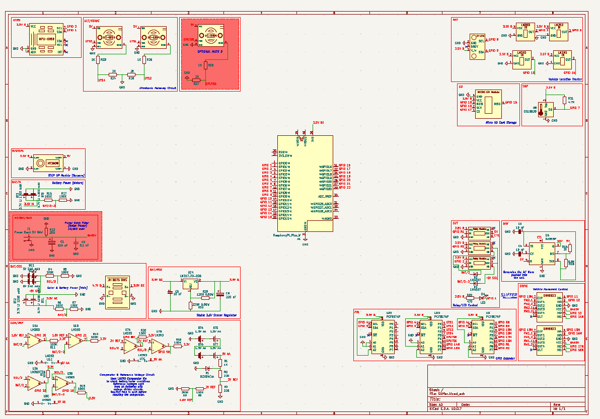

# Sliffer
A small robot that maps the salinity of an area and then uses ai to analyze types of crops suitable. [With other parameter inputs]

## Circuit Schematic

Work in progress: Sliffer is still being built and this is the current state of the circuit as of November 6, 2026. Designed in KiCad. A Raspberry Pi Pico W is the brain. It reads an MPU-6050 gyroscope, a GY-271 compass, a DS18B20 temperature sensor and four LM393 IR wheel encoders for location tracking, triggers two HC-SR04 ultrasonic sensors through PCF8574 GPIO expanders (a third is optional) and logs to a micro SD card. Two DRV8833 drivers run the N20 geared motors, with relay modules and a status LED for control. An NE555 generates the AC wave for the salinity probes, and LM393 comparators with a resistor-divider reference watch the battery and solar rails. Power comes from a 2S1P lithium pack with a BMS and 5 V solar panels, an MT3608 step-up module for the sensors and an LM317 regulator for the 3.3 V rail.

<b>Schematic.</b>

